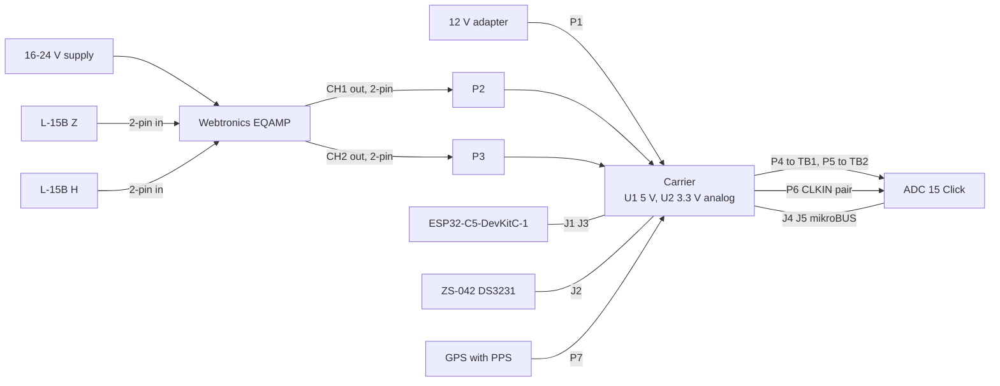
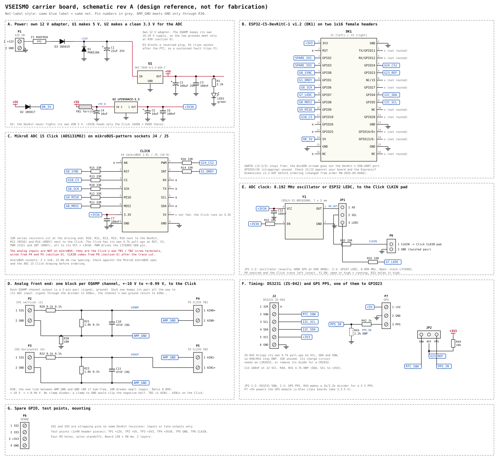
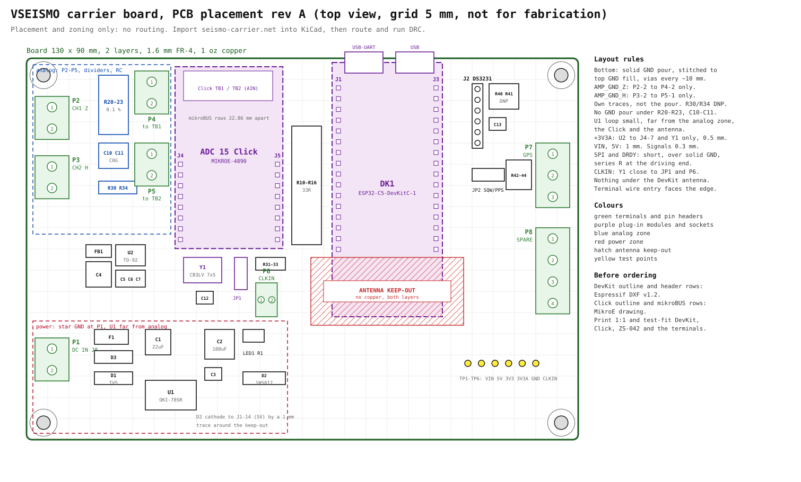

# esp32seismo carrier board, rev A

The carrier for [esp32seismo](../../README.md). Three modules plug into female headers on it:

- the ESP32-C5-DevKitC-1
- the MikroE ADC 15 Click
- a ZS-042 DS3231 module

Everything else is on the carrier: the 12 V to 5 V converter, a separate quiet 3.3 V for the ADC, one analog front-end block per amplifier channel, the 8.192 MHz ADC clock, and the GPS PPS input.

It follows the esp32nixie carrier board pattern: one generator script, hand-placed drawings, and a KiCad netlist for layout. The analog reasoning is in [main README, Hardware](../../README.md#hardware). The firmware pin map it matches is in [main README, Firmware Architecture](../../README.md#firmware-architecture).

> [!WARNING]
> **Rev A is a design reference, not a fab-ready board.**
> The drawings are hand placed. `seismo-carrier.net` comes from the same parts list and is the starting point for layout. Before ordering, take these from the vendor drawings:
> - the DevKit outline and header rows, from Espressif's Dimensions v1.2 DXF
> - the Click outline and mikroBUS row spacing, from MikroE
> - the CB3LV land pattern, from the CTS datasheet
> - the ZS-042 header position, from the module in hand

## Files

In this folder:

| File | What |
|---|---|
| `seismo-carrier-schematic.svg` | Schematic, net-label style, sections A to G |
| `seismo-carrier-pcb.svg` | Placement, zones, layout rules (no routing) |
| `seismo-carrier.net` | KiCad netlist (s-expression) for Pcbnew Import Netlist |
| [Netlist](#netlist) below | Net table, generated |
| [Footprints](#footprints) below | KiCad footprint per part, generated |
| `gen_seismo_carrier.py` | Source of all of the above: `python3 gen_seismo_carrier.py .` |

Connections live in the `PARTS` list at the bottom of the script, and the drawing helpers are copied from the Nixie generator. The KiCad steps are the same as in esp32nixie KiCad workflow. Running the script also writes the net and footprint tables as Markdown next to it.

## System wiring

- **One block per channel.** Each EQAMP channel has a 2-pin input from its geophone (into the LT1007) and a 2-pin output (signal and ground). The carrier keeps each output pair intact all the way to the ADC: the signal goes through the divider to AINx+, and that channel's own ground return goes to AINx−. That's a pseudo-differential input per channel.
- **Two supplies, one ground link.** The EQAMP keeps its own 16-24 V supply. Its ground arrives on P2-2 and P3-2 as `AMP_GND` and joins `GND` only at R30.
- **Two 3.3 V rails, on purpose:**
  - `+3V3` is the DevKit's own LDO. That regulator also feeds the ESP32 radio, so the rail carries WiFi transmit bursts. On the carrier it only feeds the DS3231, the pull-ups and the spare terminal.
  - `+3V3A` is a dedicated quiet rail: 5 V through FB1 into U2. It feeds only the Click and Y1. The Click ties the ADC's AVDD and DVDD to its mikroBUS 3.3V pin, so whatever sits on that pin reaches the analog front end.
- **Not on mikroBUS.** The Click's analog inputs are its own screw terminals, and CLKIN is a pad on the Click. Both come from the carrier on short twisted-pair pigtails (P4, P5, P6).

## Schematic

## PCB placement

## Connectors

Screw terminals are Phoenix MKDS 1,5 at 5.08 mm. Module sockets and the CLKIN header are 2.54 mm.

| Ref | Pins | Function |
|---|---|---|
| P1 | 1 +12V, 2 GND | 12 V adapter in |
| P2 | 1 SIG, 2 GND | EQAMP channel 1 output, vertical (Z), ±10 V |
| P3 | 1 SIG, 2 GND | EQAMP channel 2 output, horizontal (H), ±10 V |
| P4 | 1 AIN0+, 2 AIN0− | To the Click TB1, same order as TB1 |
| P5 | 1 AIN1−, 2 AIN1+ | To the Click TB2, same order as TB2, so the pair doesn't cross |
| P6 | 1 CLKIN, 2 GND | To the Click CLKIN pad after the LTC6903 trace cut, twisted pair |
| P7 | 1 +5V, 2 GND, 3 PPS | GPS module power and PPS |
| P8 | 1 IO2, 2 IO3, 3 +3V3, 4 GND | Spare GPIO |
| J1, J3 | 2 × 1x16 female | ESP32-C5-DevKitC-1 v1.2 |
| J4, J5 | 2 × 1x8 female, mikroBUS pattern | ADC 15 Click |
| J2 | 1x6 female | ZS-042: 32K, SQW, SCL, SDA, VCC, GND |
| JP1 | 3-pin + shunt | ADC clock: 1-2 Y1, 2-3 GPIO7 LEDC, open = stock LTC6903 |
| JP2 | 3-pin + shunt | 1 Hz reference: 1-2 DS3231 SQW, 2-3 GPS PPS |

## DevKit pin use (v1.2 headers)

| Header pin | Signal | Net | Goes to |
|---|---|---|---|
| J1-1 | 3V3 | +3V3 | J2 VCC, R40/R41/R44, P8-3 |
| J1-3 | GPIO2 | SPARE_IO2 | P8-1 |
| J1-4 | GPIO3 | SPARE_IO3 | P8-2 |
| J1-5 | GPIO0 | G0_SYNC | R15 → Click RST (SYNC/RESET) |
| J1-6 | GPIO1 | G1_DRDY | R14 ← Click INT (DRDY) |
| J1-7 | GPIO6 | G6_SCK | R10 → Click SCK |
| J1-8 | GPIO7 | G7_LEDC | R32 → JP1-3 |
| J1-9 | GPIO8 | G8_MOSI | R11 → Click MOSI |
| J1-10 | GPIO9 | G9_MISO | R12 ← Click MISO |
| J1-11 | GPIO10 | G10_CS | R13 → Click CS |
| J1-14 | 5V | DK_5V | from +5V through D2 |
| J1-15, J3-1/12/15 | GND | GND | |
| J3-4 | GPIO24 | G24_CS2 | R16 → Click PWM (LTC6903 SEN) |
| J3-5 | GPIO23 | G23_REF | JP2-2, R44 pull-up |
| J3-8 | GPIO4 | I2C_SDA | J2-4 |
| J3-9 | GPIO5 | I2C_SCL | J2-3 |
| J1-2, J1-12/13, J3-2/3, J3-7, J3-11, J3-13/14 | RST, GPIO26/25, UART0, GPIO27, GPIO28, USB | not routed | DevKit's own buttons, LED and USB ports |

## Click pin use (mikroBUS pattern)

| Socket pad | mikroBUS | Net |
|---|---|---|
| J4-1 | AN | not connected |
| J4-2 | RST | ADC_RST (SYNC/RESET) |
| J4-3 | CS | ADC_CS |
| J4-4 | SCK | ADC_SCK |
| J4-5 | MISO | ADC_MISO |
| J4-6 | MOSI | ADC_MOSI |
| J4-7 | 3.3V | +3V3A from U2 |
| J4-8 | GND | GND |
| J5-1 | PWM | ADC_CS2 (LTC6903 SEN) |
| J5-2 | INT | ADC_DRDY |
| J5-3..6 | RX, TX, SCL, SDA | not connected |
| J5-7 | 5V | not connected, the Click runs on 3.3 V |
| J5-8 | GND | GND |

## Netlist

Generated. The same data as `seismo-carrier.net`.

| Net | Members |
|---|---|
| GND | C1-2, C2-2, C3-2, C4-2, C5-2, C6-2, C7-2, C12-2, C13-2, D1-2, J1-15, J2-6, J3-1, J3-12, J3-15, J4-8, J5-8, LED1-1, P1-2, P6-2, P7-2, P8-4, R30-2, R43-2, TP5-1, U1-2, U2-2, Y1-2 |
| +3V3 | C13-1, J1-1, J2-5, P8-3, R40-2, R41-2, R44-2, TP3-1 |
| +3V3A | C5-1, C6-1, C7-1, C12-1, J4-7, R31-2, TP4-1, U2-1, Y1-4 |
| +5V | C2-1, C3-1, D2-2, FB1-1, P7-1, R1-1, TP2-1, U1-3 |
| +5V_A | C4-1, FB1-2, U2-3 |
| +12V | C1-1, D1-1, D3-1, TP1-1, U1-1 |
| +12V_F | D3-2, F1-2 |
| +12V_RAW | F1-1, P1-1 |
| ADC_CS | J4-3, R13-2 |
| ADC_CS2 | J5-1, R16-2 |
| ADC_DRDY | J5-2, R14-1 |
| ADC_MISO | J4-5, R12-1 |
| ADC_MOSI | J4-6, R11-2 |
| ADC_RST | J4-2, R15-2 |
| ADC_SCK | J4-4, R10-2 |
| AIN0P | C10-1, P4-1, R20-2, R21-1 |
| AIN1P | C11-1, P5-2, R22-2, R23-1 |
| AMP_GND | C10-2, C11-2, P2-2, P3-2, P4-2, P5-1, R21-2, R23-2, R30-1 |
| AMP_H | P3-1, R22-1 |
| AMP_Z | P2-1, R20-1 |
| CLKIN | P6-1, R33-2, TP6-1 |
| CLK_SEL | JP1-2, R33-1 |
| DK_5V | D2-1, J1-14 |
| G0_SYNC | J1-5, R15-1 |
| G1_DRDY | J1-6, R14-2 |
| G6_SCK | J1-7, R10-1 |
| G7_LEDC | J1-8, R32-1 |
| G8_MOSI | J1-9, R11-1 |
| G9_MISO | J1-10, R12-2 |
| G10_CS | J1-11, R13-1 |
| G23_REF | J3-5, JP2-2, R44-1 |
| G24_CS2 | J3-4, R16-1 |
| GPS_PPS | P7-3, R42-1 |
| I2C_SCL | J2-3, J3-9, R41-1 |
| I2C_SDA | J2-4, J3-8, R40-1 |
| LED1_A | LED1-2, R1-2 |
| LEDC_CLK | JP1-3, R32-2 |
| PPS_IN | JP2-3, R42-2, R43-1 |
| RTC_SQW | J2-2, JP2-1 |
| SPARE_IO2 | J1-3, P8-1 |
| SPARE_IO3 | J1-4, P8-2 |
| XO_EN | R31-1, Y1-1 |
| XO_OUT | JP1-1, Y1-3 |

## Bill of materials

MPNs carried over from the Nixie carrier BOM are marked "as Nixie". The rest are proposals, and their stock is unchecked.

| Ref | Qty | Part | MPN |
|---|---|---|---|
| Adapter (off-board) | 1 | 12 V DC, about 1 A | any regulated |
| DK1 | 1 | ESP32-C5-DevKitC-1-N8R8 | Espressif |
| Click | 1 | ADC 15 Click | MIKROE-4890 |
| RTC | 1 | ZS-042 DS3231 module | generic, DS3231SN preferred |
| Y1 | 1 | 8.192 MHz 3.3 V HCMOS oscillator, 7 × 5 mm SMD, tri-state enable | CTS CB3LV-3I-8M192000 |
| U1 | 1 | 5 V 1.5 A switching regulator, 7805 pinout | OKI-78SR-5/1.5-W36-C (as Nixie) |
| U2 | 1 | 3.3 V 100 mA LDO, TO-92 | LP2950ACZ-3.3 (verify part and pinout) |
| F1 | 1 | PTC 0.5 A hold | RXEF050 (as Nixie) |
| D1 | 1 | TVS 600 W, 15.3 V standoff | P6KE18A (as Nixie) |
| D2 | 1 | Schottky 1 A | 1N5817RLG (as Nixie) |
| D3 | 1 | Schottky 1 A, reverse block | 1N5819RLG (as Nixie) |
| FB1 | 1 | Axial ferrite bead | Fair-Rite 2743001112 (verify) |
| C1 | 1 | 22 µF 25 V electrolytic | EEU-FR1E220 (as Nixie) |
| C2 | 1 | 100 µF 25 V electrolytic | EEU-FR1E101 (as Nixie) |
| C4, C5 | 2 | 10 µF 16 V electrolytic, 5 mm | to choose |
| C3, C6, C7, C12, C13 | 5 | 100 nF 50 V X7R | C320C104K5R5TA (as Nixie) |
| C10, C11 | 2 | 47 nF C0G/NP0, 5 mm pitch | to choose, C0G only |
| R20, R22 | 2 | 9.1k 0.1 % 25 ppm metal film | to choose |
| R21, R23 | 2 | 1.0k 0.1 % 25 ppm metal film | to choose |
| R10-R16, R32, R33 | 9 | 33 Ω 1/4 W (0 Ω links work too) | to choose |
| R30 | 1 | 10 Ω 1/4 W (or a 0 Ω link) | to choose |
| R1 | 1 | 2.2k 1/4 W | CF14JT2K20 (as Nixie) |
| R31, R44 | 2 | 10k 1/4 W | CF14JT10K0 (as Nixie) |
| R42 | 1 | 1k 1/4 W | CF14JT1K00 (as Nixie) |
| R40, R41 (DNP) | 2 | 4.7k 1/4 W | CF14JT4K70 (as Nixie) |
| R43 (DNP) | 1 | 2.2k 1/4 W | CF14JT2K20 (as Nixie) |
| LED1 | 1 | 3 mm green | WP710A10GD (as Nixie) |
| P1-P5 | 5 | 2-pos screw terminal, 5.08 mm | 1715721 (as Nixie) |
| P7 | 1 | 3-pos screw terminal, 5.08 mm | 1715734 (verify, as Nixie) |
| P8 | 1 | 4-pos screw terminal, 5.08 mm | to choose |
| J1, J3, J4, J5, J2 | 1 strip | 1x20 female header, cut to length | PPTC201LFBN-RC (as Nixie) |
| JP1, JP2, P6, TP1-TP6 | 1 strip | 1x40 male breakaway header | PREC040SAAN-RC (as Nixie) |
| JP1, JP2 shunts | 2 | Jumper shunt | QPC02SXGN-RC (as Nixie) |
| Mechanical | 4 | M3 nylon standoffs + screws | any |

PCB: JLCPCB or PCBWay, 2 layers, 130 × 90 mm, 1.6 mm, 1 oz, HASL.

## Design notes

- **Divider.** 9.1k over 1.0k gives 0.099. The EQAMP's ±10 V becomes ±0.99 V, and even a ±12 V rail clip stays at ±1.19 V, inside the ±1.2 V full scale. The 0.1 % parts keep the two channels matched before any calibration.
- **Pseudo-differential per channel.** AINx− is that channel's own amplifier ground, not the carrier ground. A small voltage between amplifier ground and carrier ground then cancels in the ADC instead of landing in the record.
- **No clamp diodes.** A clamp to GND would conduct at about −0.6 V and clip the negative half of the signal. The divider keeps a rail-to-rail amplifier inside the ADC range. If the Click is unpowered, the 9.1k limits the current into its ESD diodes to about 1 mA.
- **RC.** 47 nF on the 1.0k (about 0.9k Thevenin) puts a pole near 3.7 kHz. That's plenty of anti-aliasing for a ΔΣ modulator running at MHz rates, and it also feeds the ADC's input sampling charge. C0G only, since X7R distorts.
- **Ground link.** R30 is the only path between `AMP_GND` and `GND`. 10 Ω breaks small loops but keeps the ADC reference. Fit 0 Ω if there's no hum. Route each channel's ground return as its own trace, P2-2 to P4-2 and P3-2 to P5-1, not through the pour.
- **+3V3A.** FB1, C4, U2 (LP2950, 100 mA, needs at least 1 µF on its output), C5 and C6.
  - Load is under 30 mA: the ADC, the LTC6903, the Click LED and Y1.
  - Both 3.3 V rails come from the same 5 V, so they rise together, and the Click's 4.7k pull-ups can't back-feed a DevKit that's off.
- **33 Ω series resistors** sit at the driving end of every SPI and control line. They're cheap insurance, not a requirement:
  - They soften edges and damp ringing on the socket-and-header path, which avoids double-counted clock edges.
  - They limit current if one module is powered and the other isn't.

  At 8 MHz on short traces it would very likely work without them, so 0 Ω links are fine.
- **Y1, CTS CB3LV-3I-8M192000.** 8.192 MHz, 3.3 V HCMOS, 7 × 5 mm SMD. Pins: 1 enable (open or high = running, low = high impedance), 2 GND, 3 output, 4 VCC. R31 holds enable high, and C12 (100 nF, the datasheet asks for at least 10 nF) sits at pin 4. It's the only SMD part on the board, with large pads that are easy to hand-solder.
  - JP1 1-2 gives exactly 1000 SPS at OSR 4096 (firmware `clk_src=ext`).
  - JP1 2-3 uses GPIO7 LEDC (`clk_src=ledc`).
  - With the stock Click, leave JP1 open and P6 unwired, don't cut the trace, and set `clk_src=ltc6903`.
- **1 Hz reference.** JP2 picks the DS3231 SQW or the GPS PPS. R44 is the pull-up the open-drain SQW needs. R42 protects GPIO23 from a 5 V PPS, and R43 (DNP) turns it into a 1k/2.2k divider if the GPS drives a 5 V PPS.
- **ZS-042.** It has 4.7k pull-ups on SCL, SDA and SQW, so R40/R41 stay DNP. Its charge circuit (200 Ω and a diode from VCC) is meant for an LIR2032. With a plain CR2032, remove the diode.
- **Power.** Same front end as the Nixie carrier, with D3 added as a reverse-polarity block. D1 sits after F1, so a sustained overvoltage trips the PTC.
  - 5 V budget: about 180 mA average and 450 mA peak for the DevKit, plus about 30 mA for a GPS module, against U1's 1.5 A.
  - D2 keeps the carrier from fighting the DevKit's USB 5 V.

## Bring-up order

1. **Bare board, no modules.** U1, U2 and Y1 fitted. Apply 12 V on P1, then check:
   - TP1 = 12 V, TP2 = 5 V, TP4 = 3.3 V, LED1 on, nothing warm.
   - Reverse the plug once: nothing should happen.
2. **JP1 on 1-2.** Scope TP6 for 8.192 MHz with a clean edge.
3. **DevKit in, USB only, carrier unpowered.**
   - The ESP boots normally (strapping is untouched).
   - TP2 stays near 0 V (no back-feed through D2).
4. **Carrier powered with the DevKit in.** TP3 = 3.3 V.
5. **ZS-042 on J2, JP2 on 1-2.** With `rtc 1` and `ref rtc` set, the console shows the DS3231 and 1 Hz edges.
6. **Click in.**
   - Click unmodified, JP1 open, `clk_src=ltc6903`: the console shows "ADC ok, ID 0x22xx".
   - Then cut the LTC6903 trace, wire P6 to the CLKIN pad, set JP1 1-2 and `clk_src=ext`.
7. **P4 and P5 pigtails to the Click TB1 and TB2.** Short P2 and P3 (SIG to GND) and read the noise floor on the web page. It should match the "Shorted" mux reading.
8. **EQAMP channel outputs on P2 and P3, with the EQAMP on its own supply.** Check for hum. If hum shows up, try R30 at 0 Ω, then 10 Ω.

## Footprints

Generated. KiCad footprint per part.

| Ref | Value | Footprint | Note |
|---|---|---|---|
| C1 | 22uF 25V | `Capacitor_THT:CP_Radial_D6.3mm_P2.50mm` |  |
| C2 | 100uF 25V | `Capacitor_THT:CP_Radial_D6.3mm_P2.50mm` |  |
| C3 | 100nF | `Capacitor_THT:C_Disc_D5.0mm_W2.5mm_P5.00mm` |  |
| C4 | 10uF 16V | `Capacitor_THT:CP_Radial_D5.0mm_P2.00mm` |  |
| C5 | 10uF 16V | `Capacitor_THT:CP_Radial_D5.0mm_P2.00mm` | LP2950 needs >= 1 uF |
| C6 | 100nF | `Capacitor_THT:C_Disc_D5.0mm_W2.5mm_P5.00mm` |  |
| C7 | 100nF | `Capacitor_THT:C_Disc_D5.0mm_W2.5mm_P5.00mm` | at J4 pin 7 |
| C10 | 47nF C0G | `Capacitor_THT:C_Disc_D5.0mm_W2.5mm_P5.00mm` | C0G/NP0 only |
| C11 | 47nF C0G | `Capacitor_THT:C_Disc_D5.0mm_W2.5mm_P5.00mm` | C0G/NP0 only |
| C12 | 100nF | `Capacitor_THT:C_Disc_D5.0mm_W2.5mm_P5.00mm` | at Y1 pin 4, datasheet asks >= 10 nF |
| C13 | 100nF | `Capacitor_THT:C_Disc_D5.0mm_W2.5mm_P5.00mm` | at J2 VCC |
| D1 | P6KE18A | `Diode_THT:D_DO-15_P10.16mm_Horizontal` | TVS, unidirectional, cathode to +12V |
| D2 | 1N5817 | `Diode_THT:D_DO-41_SOD81_P10.16mm_Horizontal` |  |
| D3 | 1N5819 | `Diode_THT:D_DO-41_SOD81_P10.16mm_Horizontal` | reverse-polarity block |
| F1 | RXEF050 | `Capacitor_THT:C_Disc_D7.5mm_W5.0mm_P5.00mm` | footprint is a stand-in, check the RXEF050 drawing |
| FB1 | ferrite bead | `Resistor_THT:R_Axial_DIN0207_L6.3mm_D2.5mm_P10.16mm_Horizontal` | axial bead; resistor footprint as a stand-in, check the bead drawing |
| J1 | DevKit J1 | `Connector_PinSocket_2.54mm:PinSocket_1x16_P2.54mm_Vertical` |  |
| J2 | DS3231 ZS-042 | `Connector_PinSocket_2.54mm:PinSocket_1x06_P2.54mm_Vertical` | module order 32K SQW SCL SDA VCC GND; 32K not connected |
| J3 | DevKit J3 | `Connector_PinSocket_2.54mm:PinSocket_1x16_P2.54mm_Vertical` |  |
| J4 | Click mikroBUS 1-8 | `Connector_PinSocket_2.54mm:PinSocket_1x08_P2.54mm_Vertical` | 1 AN not connected |
| J5 | Click mikroBUS 16-9 | `Connector_PinSocket_2.54mm:PinSocket_1x08_P2.54mm_Vertical` | pad 1 = PWM (16) .. pad 8 = GND (9); RX TX SCL SDA 5V not connected |
| JP1 | CLK SEL | `Connector_PinHeader_2.54mm:PinHeader_1x03_P2.54mm_Vertical` | 1-2 = oscillator, 2-3 = GPIO7 LEDC, open = stock LTC6903 |
| JP2 | REF SEL | `Connector_PinHeader_2.54mm:PinHeader_1x03_P2.54mm_Vertical` | 1-2 = DS3231 SQW, 2-3 = GPS PPS |
| LED1 | green | `LED_THT:LED_D3.0mm` |  |
| P1 | 12V IN | `TerminalBlock_Phoenix:TerminalBlock_Phoenix_MKDS-1,5-2-5.08_1x02_P5.08mm_Horizontal` |  |
| P2 | CH1 Z IN | `TerminalBlock_Phoenix:TerminalBlock_Phoenix_MKDS-1,5-2-5.08_1x02_P5.08mm_Horizontal` |  |
| P3 | CH2 H IN | `TerminalBlock_Phoenix:TerminalBlock_Phoenix_MKDS-1,5-2-5.08_1x02_P5.08mm_Horizontal` |  |
| P4 | TO CLICK TB1 | `TerminalBlock_Phoenix:TerminalBlock_Phoenix_MKDS-1,5-2-5.08_1x02_P5.08mm_Horizontal` |  |
| P5 | TO CLICK TB2 | `TerminalBlock_Phoenix:TerminalBlock_Phoenix_MKDS-1,5-2-5.08_1x02_P5.08mm_Horizontal` |  |
| P6 | CLKIN | `Connector_PinHeader_2.54mm:PinHeader_1x02_P2.54mm_Vertical` | twisted pair to the Click CLKIN pad |
| P7 | GPS | `TerminalBlock_Phoenix:TerminalBlock_Phoenix_MKDS-1,5-3-5.08_1x03_P5.08mm_Horizontal` |  |
| P8 | SPARE | `TerminalBlock_Phoenix:TerminalBlock_Phoenix_MKDS-1,5-4-5.08_1x04_P5.08mm_Horizontal` |  |
| R1 | 2.2k | `Resistor_THT:R_Axial_DIN0207_L6.3mm_D2.5mm_P10.16mm_Horizontal` |  |
| R10 | 33R | `Resistor_THT:R_Axial_DIN0207_L6.3mm_D2.5mm_P10.16mm_Horizontal` |  |
| R11 | 33R | `Resistor_THT:R_Axial_DIN0207_L6.3mm_D2.5mm_P10.16mm_Horizontal` |  |
| R12 | 33R | `Resistor_THT:R_Axial_DIN0207_L6.3mm_D2.5mm_P10.16mm_Horizontal` | place at the Click |
| R13 | 33R | `Resistor_THT:R_Axial_DIN0207_L6.3mm_D2.5mm_P10.16mm_Horizontal` |  |
| R14 | 33R | `Resistor_THT:R_Axial_DIN0207_L6.3mm_D2.5mm_P10.16mm_Horizontal` | place at the Click |
| R15 | 33R | `Resistor_THT:R_Axial_DIN0207_L6.3mm_D2.5mm_P10.16mm_Horizontal` |  |
| R16 | 33R | `Resistor_THT:R_Axial_DIN0207_L6.3mm_D2.5mm_P10.16mm_Horizontal` |  |
| R20 | 9.1k 0.1% | `Resistor_THT:R_Axial_DIN0207_L6.3mm_D2.5mm_P10.16mm_Horizontal` | 0.1 %, 25 ppm metal film |
| R21 | 1.0k 0.1% | `Resistor_THT:R_Axial_DIN0207_L6.3mm_D2.5mm_P10.16mm_Horizontal` | 0.1 %, 25 ppm metal film |
| R22 | 9.1k 0.1% | `Resistor_THT:R_Axial_DIN0207_L6.3mm_D2.5mm_P10.16mm_Horizontal` | 0.1 %, 25 ppm metal film |
| R23 | 1.0k 0.1% | `Resistor_THT:R_Axial_DIN0207_L6.3mm_D2.5mm_P10.16mm_Horizontal` | 0.1 %, 25 ppm metal film |
| R30 | 10R | `Resistor_THT:R_Axial_DIN0207_L6.3mm_D2.5mm_P10.16mm_Horizontal` | single AMP_GND to GND link; 0R if there is no hum |
| R31 | 10k | `Resistor_THT:R_Axial_DIN0207_L6.3mm_D2.5mm_P10.16mm_Horizontal` |  |
| R32 | 33R | `Resistor_THT:R_Axial_DIN0207_L6.3mm_D2.5mm_P10.16mm_Horizontal` |  |
| R33 | 33R | `Resistor_THT:R_Axial_DIN0207_L6.3mm_D2.5mm_P10.16mm_Horizontal` |  |
| R40 | 4.7k | `Resistor_THT:R_Axial_DIN0207_L6.3mm_D2.5mm_P10.16mm_Horizontal` | DNP: ZS-042 has its own |
| R41 | 4.7k | `Resistor_THT:R_Axial_DIN0207_L6.3mm_D2.5mm_P10.16mm_Horizontal` | DNP: ZS-042 has its own |
| R42 | 1k | `Resistor_THT:R_Axial_DIN0207_L6.3mm_D2.5mm_P10.16mm_Horizontal` |  |
| R43 | 2.2k | `Resistor_THT:R_Axial_DIN0207_L6.3mm_D2.5mm_P10.16mm_Horizontal` | DNP; fit for a 5 V PPS output |
| R44 | 10k | `Resistor_THT:R_Axial_DIN0207_L6.3mm_D2.5mm_P10.16mm_Horizontal` |  |
| TP1 | +12V | `Connector_PinHeader_2.54mm:PinHeader_1x01_P2.54mm_Vertical` |  |
| TP2 | +5V | `Connector_PinHeader_2.54mm:PinHeader_1x01_P2.54mm_Vertical` |  |
| TP3 | +3V3 | `Connector_PinHeader_2.54mm:PinHeader_1x01_P2.54mm_Vertical` |  |
| TP4 | +3V3A | `Connector_PinHeader_2.54mm:PinHeader_1x01_P2.54mm_Vertical` |  |
| TP5 | GND | `Connector_PinHeader_2.54mm:PinHeader_1x01_P2.54mm_Vertical` |  |
| TP6 | CLKIN | `Connector_PinHeader_2.54mm:PinHeader_1x01_P2.54mm_Vertical` |  |
| U1 | OKI-78SR-5/1.5-W36-C | `Converter_DCDC:Converter_DCDC_Murata_OKI-78SR_Vertical` | pins IN-GND-OUT; check caps against the Murata datasheet |
| U2 | LP2950ACZ-3.3 | `Package_TO_SOT_THT:TO-92_Inline` | TO-92 1 OUT, 2 GND, 3 IN; verify against the datasheet |
| Y1 | CB3LV-3I-8M192000 | `seismo:Oscillator_CTS_CB3LV_7.0x5.0mm` | CTS 8.192 MHz 3.3 V HCMOS, 1 EN 2 GND 3 OUT 4 VCC; project footprint from the CB3LV land pattern |

## Firmware impact

None. The carrier matches [`main/io_map.h`](../../main/io_map.h). Settings that depend on jumpers: `clk_src` follows JP1, `ref` follows JP2, and `rtc 1` goes with a fitted ZS-042.

## Open items

- A KiCad footprint for the CB3LV. The netlist names a project footprint, `seismo:Oscillator_CTS_CB3LV_7.0x5.0mm`, to draw from the CTS land pattern. One copy of the datasheet is titled 7.5 × 5 mm, so check the revision.
- Verify the LP2950ACZ-3.3 TO-92 pinout and the ferrite bead part.
- The Click outline, the mikroBUS row spacing and the CLKIN pad position, from the MikroE drawing.
- DevKit revision (v1.1 or v1.2) and the J1/J3 pinout on the board in hand.
- The ZS-042 header position relative to its mounting hole, for a 1:1 fit.
- KiCad: import, footprint check (F1 and FB1 are stand-ins, Y1 is a project footprint), routing, DRC.

## Related

- [Main README](../../README.md)
- [HTTP API](../../doc/API.md)
